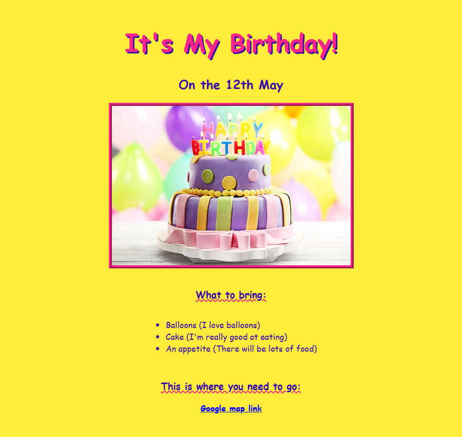

# Fødselsdagsinvitation

🌐 [English](Home) · **Dansk** · [Bahasa Melayu](Home-ms)

En fødselsdagsinvitation i retro 90'er-stil, lavet med almindelig HTML og CSS.
Dag 42 af Udemy-kurset "100 Days of Code" i webudvikling.

## Hvad siden bruger

| Element | Bruges til |
| --- | --- |
| `<h1>`, `<h2>`, `<h3>` | Titlen, datoen og overskrifterne |
| `` | Fødselsdagskagen, med `alt`-tekst |
| `<ul>` og `<li>` | Hvad gæsterne tager med |
| `<a>` | Google Maps-linket til festen |

## Filer

| Fil | Formål |
| --- | --- |
| `src/index.html` | Selve siden |
| `src/style.css` | Farver, skrifttype, rammer og layout, linket fra siden |

## Kør den

Intet build-trin. Åbn `src/index.html` i en browser.

## Styling

Stilene ligger i `src/style.css`, ikke i HTML'en. Fire brugerdefinerede
egenskaber øverst (`--bg`, `--ink`, `--accent`, `--link`) sætter farverne, så et
nyt udseende er en ændring af fire værdier.
